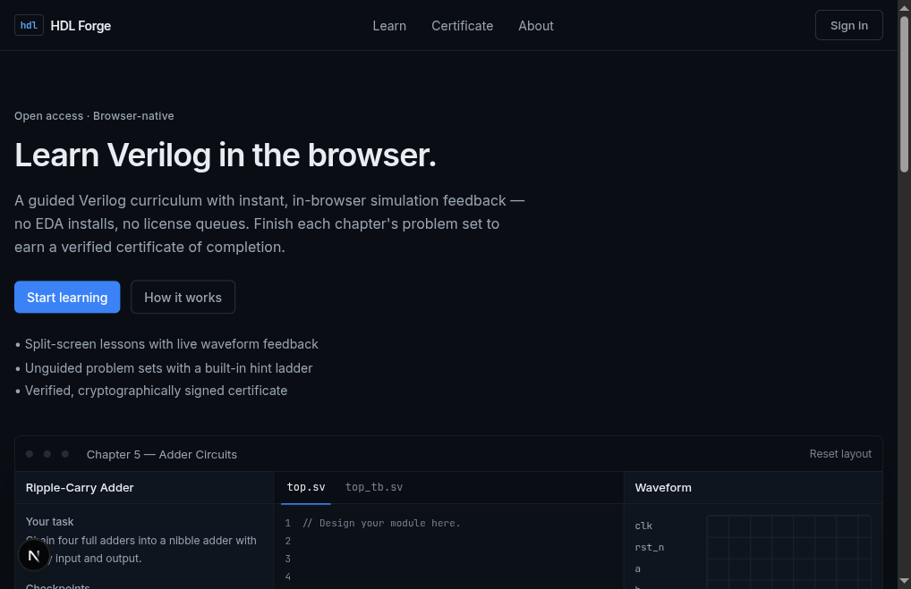
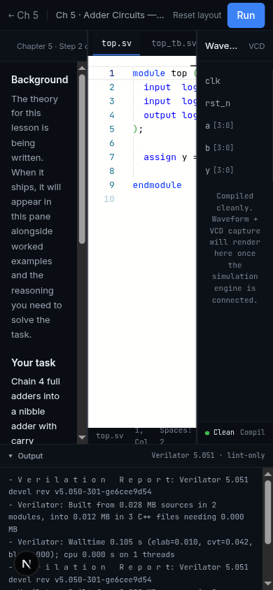
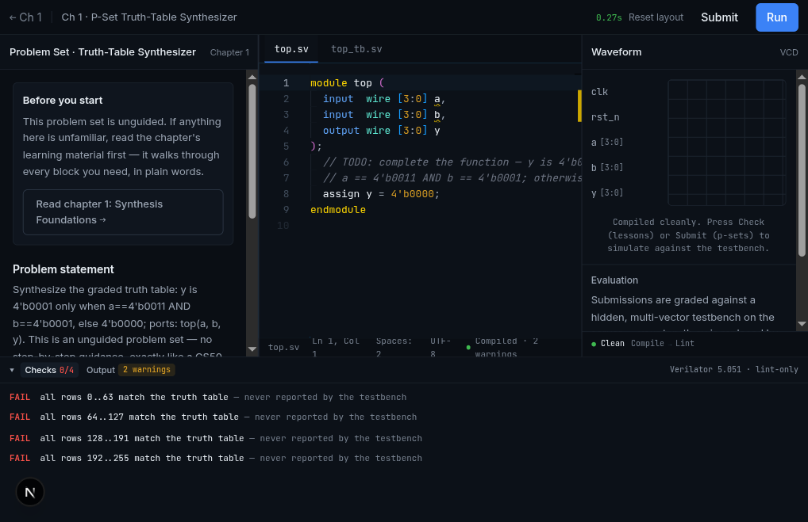
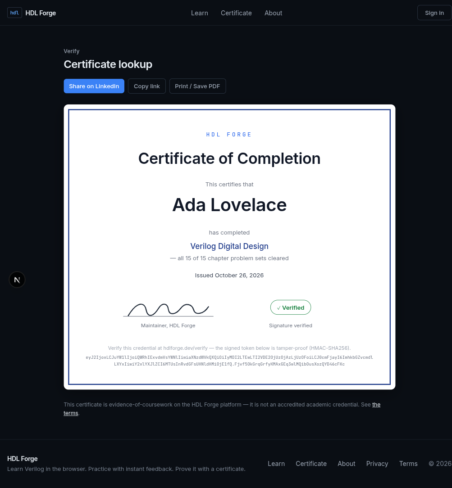

# HDL Forge

An open-access, browser-native Verilog learning and certification platform.

Merges **FreeCodeCamp**'s split-screen interactive micro-lessons with
**Harvard CS50**'s rigorous evaluation model: students practice step-by-step
logic design in the browser, complete unguided end-of-chapter problem sets
that are submitted and graded automatically against hidden testbenches, and
earn a verified, cryptographic certificate of completion. Every problem set
includes a built-in three-step hint ladder and post-failure pitfall
checklists, so being stuck never means being alone; a one-line glossary of
every term in the track lives at `/glossary`.

> **Status: functional build.** All 15 chapters (19 lessons + 15 problem
> sets) are populated and verified — every lesson's reference solution passes
> its hidden bench and every deliberately broken starter fails. The browser
> workspace checks lessons against the bundled bench via `/api/sim` and
> grades problem sets against hidden benches via `/api/grade`. Google
> sign-in syncs progress to a Neon Postgres account (Better Auth); without
> it, progress lives in localStorage on this device.

## Screenshots

| | |
| --- | --- |
|  |  |
| Landing | Lesson workspace: theory · editor · waveform, Verilator lint in-browser |
|  |  |
| P-Set autograder with hint ladder | Signed, verifiable certificate |

## Routes

| Route | Purpose |
| --- | --- |
| `/` | Landing page |
| `/learn` | Curriculum map (FreeCodeCamp-style track) |
| `/learn/[chapter]` | Chapter overview + its lessons and P-Set |
| `/learn/[chapter]/lesson/[lesson]` | Three-pane workspace (Theory · Editor · Waveform) |
| `/learn/[chapter]/pset/[pset]` | Problem set workspace + autograder + hint ladder |
| `/certificate` | Certificate preview + token verification entry |
| `/verify/[token]` | Certificate lookup |
| `/profile` | Per-track progress dashboard |
| `/signin` | Google sign-in |
| `/about` | Platform rationale, comparison, tech stack |
| `/privacy` | Privacy policy (what is stored, how to delete) |
| `/terms` | Terms of use (incl. certificate meaning) |

## Architecture

Two simulation engines, deliberately:

| Engine | Where |
| --- | --- |
| Verilator WASM | Browser, Web Worker — lint/diagnostics as you type |
| Icarus Verilog (`@veriflow/iverilog-wasm`) | Server only, via `/api/sim` and `/api/grade` |

- `/api/grade` overwrites the student's `top_tb.sv` with the hidden bench
  before simulating; hidden benches live server-only in `lib/server/psets/`
  and never reach the browser bundle.
- Lesson benches (`lib/tests-content/lessons/`) are client-visible,
  freeCodeCamp-style, and run through `/api/sim`.
- Passing a Check/Submit marks the item complete in the progress store
  (`lib/progress.ts`): localStorage for everyone, and for signed-in users a
  Postgres row per completion (Better Auth + Drizzle + Neon). `/profile` and
  the curriculum bars read the merged state; first sign-in merges local
  progress into the account.

## Accounts, database, and Vercel

Auth runs on **Better Auth** with a Google OAuth provider, sessions in
Postgres, progress rows in `lesson_progress`. Driver: Neon's serverless
HTTP adapter through Vercel's Neon Marketplace integration.

Env vars (see `.env.example`): `BETTER_AUTH_SECRET`, `BETTER_AUTH_URL`,
`GOOGLE_CLIENT_ID`, `GOOGLE_CLIENT_SECRET`, `DATABASE_URL`, `CERT_SECRET`,
plus the optional `NEXT_PUBLIC_SITE_URL`, `UPSTASH_REDIS_REST_URL/TOKEN`,
`NEXT_PUBLIC_SENTRY_DSN`, and `NEXT_PUBLIC_FEEDBACK_URL`.

### Schema migrations (not push)

Schema changes are versioned as SQL files under `drizzle/` and committed —
never `db:push` (which drifts between environments). The flow:

```bash
npm run db:generate   # diff lib/db/schema.ts → drizzle/000X_*.sql + snapshot
git add drizzle/      # commit the migration with the schema change
npm run db:migrate    # apply pending migrations (once against the prod URL,
                      # or as a CI/deploy step with DATABASE_URL set)
```

The committed baseline (`drizzle/0000_*.sql`) creates all five tables
(`user`, `session`, `account`, `verification`, `lesson_progress`) with
cascade-deleting foreign keys.

### Abuse protection & observability

- `/api/sim` (10/min) and `/api/grade` (20/hour) are rate limited per IP via
  Upstash sliding windows and reject cross-origin POSTs; when Upstash is not
  configured they fall back to a per-instance in-memory window.
- Sentry captures client WASM/worker crashes and server errors when
  `NEXT_PUBLIC_SENTRY_DSN` is set; otherwise it no-ops.
- Account self-deletion (Profile → Danger zone) cascades every stored row.

On Vercel: create a Postgres (Neon) integration, set the Google OAuth env
vars, and register `https://<your-domain>/api/auth/callback/google` as an
authorized redirect URI in Google Cloud Console. In the Google OAuth consent
screen, list the live `NEXT_PUBLIC_SITE_URL` as the site homepage and set the
privacy policy and terms URLs to `/privacy` and `/terms`.

## Development

```bash
npm run dev      # start the dev server
npm run lint     # eslint
npm run build    # production build
```

## Verification

```bash
node --import tsx scripts/verify-lesson.mjs   # all lessons: solution passes, starter fails
node --import tsx scripts/verify-pset.mjs     # hidden benches vs reference solutions
```